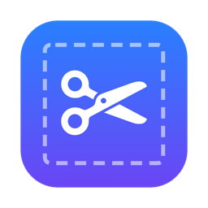
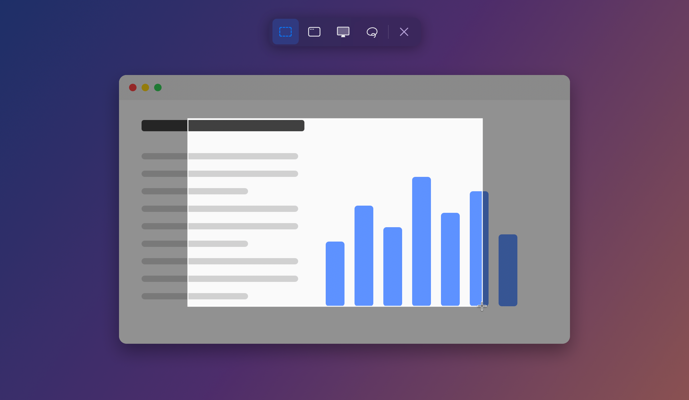
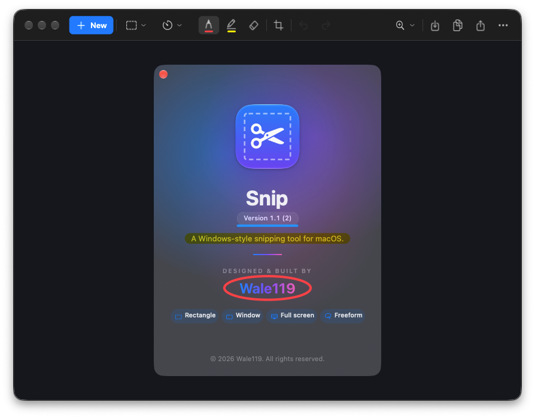
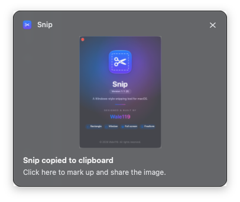
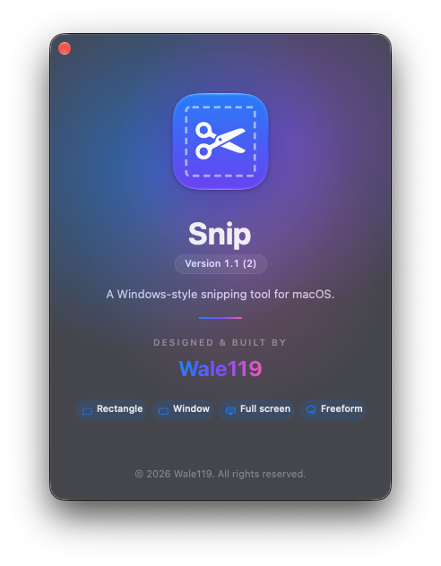

<div align="center">



# Snip

**The Windows Snipping Tool experience, on your Mac.**

Press <kbd>⇧</kbd><kbd>⌘</kbd><kbd>S</kbd>, drag, done. Your snip is already on the clipboard.




</div>

---

## Why Snip?

If you've switched from Windows, you probably miss the Snipping Tool. macOS has great screenshot
features, but they work differently: there's no instant clipboard copy plus a quick markup window, no freeze-frame
overlay with a mode bar, and no "click the notification to annotate" flow.

Snip recreates that workflow natively in Swift and AppKit. It's small, fast, and has no dependencies.

## Features

- **Same shortcut, same muscle memory.** <kbd>⇧</kbd><kbd>⌘</kbd><kbd>S</kbd> is in the same place as <kbd>⊞ Win</kbd>+<kbd>Shift</kbd>+<kbd>S</kbd>.
  You can switch to <kbd>⌃</kbd><kbd>⇧</kbd><kbd>S</kbd>, <kbd>⌥</kbd><kbd>⇧</kbd><kbd>S</kbd> or <kbd>F13</kbd> (Print Screen on PC keyboards).
- **Freeze-frame overlay.** The screen freezes and dims while you pick an area, on every display.
- **Four snipping modes:** Rectangle, Window (hover to highlight, click to capture), Full screen (all displays
  stitched together) and Freeform (draw any shape).
- **Copied to the clipboard instantly**, and optionally auto-saved to `~/Pictures/Screenshots`.
- **"Snip copied to clipboard" notification.** Click it to open the editor, or right-click it to Copy, Save As or Share.
- **Markup editor**
  - Ballpoint pen and highlighter, each with its own colors and sizes
  - Stroke eraser, plus "Erase all ink"
  - Crop with drag handles
  - Undo/redo, zoom and pinch-to-zoom
  - Save as PNG or JPEG, Copy, Share, Open in Preview
  - Right-click the snip for Copy / Save As / Share
  - Edits are copied back to the clipboard automatically
- **Snip delay** of 3, 5 or 10 seconds for menus and hover states.
- **Remembers your choices:** mode, delay, pen colors and sizes, and save folder.

## Screenshots

<table>
<tr>
<td width="62%"></td>
<td></td>
</tr>
<tr>
<td align="center"><sub>The markup editor: pen, highlighter, eraser, crop, undo / redo</sub></td>
<td align="center"><sub>Click the notification to mark up, or right-click to Copy / Save As / Share</sub></td>
</tr>
</table>

<p align="center">
<br>
<sub>About Snip</sub>
</p>

## Install

Snip is built from source. It takes about a minute and needs only Apple's free command-line tools.

**Requirements:** macOS 14 Sonoma or later on Apple silicon, and Xcode or the Command Line Tools
(`xcode-select --install`).

```bash
git clone https://github.com/Wale119/snip-for-mac.git
cd snip-for-mac
./build.sh --install
```

`--install` copies `Snip.app` to `/Applications` and launches it. Without it, the app is built into `build/Snip.app`.

### First launch: Screen Recording permission

macOS requires permission for any app to capture the screen:

1. Press <kbd>⇧</kbd><kbd>⌘</kbd><kbd>S</kbd>. macOS will ask for permission.
2. Turn on **Snip** in **System Settings → Privacy & Security → Screen & System Audio Recording**.
3. Quit Snip (<kbd>⌘</kbd><kbd>Q</kbd>) and open it again.

> **Tip:** `build.sh` signs the app with your Apple Development certificate if you have one (any free Apple ID
> signed into Xcode gives you one). That keeps the permission granted across rebuilds. Without a certificate the
> app is ad-hoc signed, and you'll need to grant the permission again after every rebuild.

## Usage

| Action | How |
| --- | --- |
| New snip from anywhere | <kbd>⇧</kbd><kbd>⌘</kbd><kbd>S</kbd> (changeable in **Snip → Keyboard Shortcut**) |
| New snip from the editor (uses the delay) | **New** button or <kbd>⌘</kbd><kbd>N</kbd> |
| Switch mode | Snipping bar, **Capture** menu, or <kbd>⌘</kbd><kbd>1</kbd>–<kbd>4</kbd> |
| Cancel a snip | <kbd>Esc</kbd> |
| Pen / highlighter color and size | Click the selected tool again |
| Apply / cancel crop | <kbd>Return</kbd> / <kbd>Esc</kbd> |
| Undo / redo | <kbd>⌘</kbd><kbd>Z</kbd> / <kbd>⇧</kbd><kbd>⌘</kbd><kbd>Z</kbd> |
| Copy / Save As | <kbd>⌘</kbd><kbd>C</kbd> / <kbd>⌘</kbd><kbd>S</kbd>, or right-click the snip |
| Zoom | <kbd>⌘</kbd><kbd>=</kbd> <kbd>⌘</kbd><kbd>-</kbd> <kbd>⌘</kbd><kbd>0</kbd> (actual size) <kbd>⌘</kbd><kbd>9</kbd> (fit), or pinch |

Settings live in the **Snip** menu: keyboard shortcut, auto-copy changes, auto-save screenshots, and save folder.
Closing the window keeps Snip running in the Dock so the shortcut keeps working. Quit with <kbd>⌘</kbd><kbd>Q</kbd>.

## How it's built

Plain Swift and AppKit, compiled with `swiftc` by [`build.sh`](build.sh). There's no Xcode project and no third-party code.

| File | What it does |
| --- | --- |
| [`Capture.swift`](Sources/Capture.swift) | Freezes every display with ScreenCaptureKit, finds windows, crops / stitches / masks snips |
| [`Overlay.swift`](Sources/Overlay.swift) | The dimmed freeze-frame overlay and the Rectangle / Window / Full screen / Freeform bar |
| [`Editor.swift`](Sources/Editor.swift) | The markup window, undo / redo, save / copy / share, right-click menu |
| [`Canvas.swift`](Sources/Canvas.swift) | Ink strokes, eraser hit-testing, crop handles, flattened export |
| [`Bar.swift`](Sources/Bar.swift) | The flat, Windows-style toolbar buttons and window chrome |
| [`Toast.swift`](Sources/Toast.swift) | The "Snip copied to clipboard" notification |
| [`HotKey.swift`](Sources/HotKey.swift) | Global shortcut via Carbon `RegisterEventHotKey` (no Accessibility permission needed) |
| [`About.swift`](Sources/About.swift) | The About window |
| [`tools/screenshots.sh`](tools/screenshots.sh) | Retakes the About, editor and notification screenshots in this README |

To refresh the screenshots, run `./tools/screenshots.sh`. It needs Screen Recording permission for your terminal and takes about 20 seconds. It only captures Snip's own windows, never the rest of your screen, and strips image metadata.

## Credits

Designed and built by **Wale119**.

Snip is an independent project. It is not affiliated with or endorsed by Microsoft or Apple.

## License

[MIT](LICENSE) © 2026 Wale119
